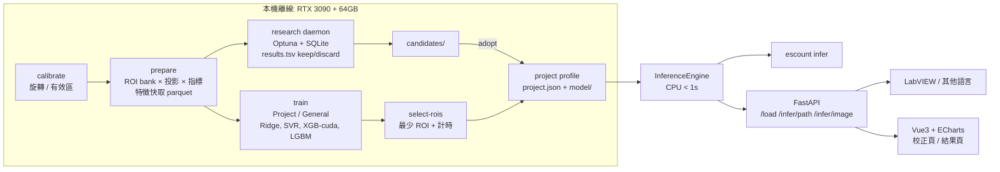

# ESCounting V4 實作計畫（電磁鋼片計數系統）

> 版本：2026-10-08　｜　授權：Proprietary（All rights reserved）　｜　Repo：`gp6fu6-csc/ES_Counting_FinancialEngineering_20261008`（private）

## 1. 專案目的

計算影像中電磁鋼片的真實堆疊數量，建立可重複使用的流程：**校正 → 訓練資料準備 → 模型訓練 / 參數研究 → 推論**，並提供 CLI、推論 Server（供 LabVIEW 等系統呼叫）與網頁 UI（校正與結果視覺化）。

## 2. 需求共識

| 項目 | 決策 |
|---|---|
| Repo 內容 | 程式碼、測試、文件、sample JSON；`Data/`、`outputs/`、`*.7z` 不上傳 |
| 依賴授權 | 僅 MIT / BSD / Apache-2.0 / PSF / ISC / LGPL（動態連結）；`scripts/check_licenses.py` 自動檢查 |
| 環境 | uv + `.venv`、Python 3.12、`pyproject.toml` + `uv.lock`（版本鎖定） |
| 準確度指標 | **唯一指標：完全命中率**（整數預測 = GT）；同分依序比 ROI 數較少、延遲較短 |
| 資料增量 | 同一影像變化 w / D / x 產生 ROI 樣本；驗證一律以影像為單位留出（Grouped LOO） |
| ROI 幾何 | 每列距 background_BW 有效區左右邊緣 ≥ 50 px（避開陰影）；相鄰重疊 < w/3（D > 2w/3）；垂直方向涵蓋整個堆疊 |
| 投影 | 僅寬度方向（平均 / 高斯加權 / 中位數），**垂直方向不平滑** |
| 推論效能 | 最少 ROI，CPU 單張 < 1 秒（不含模型載入） |
| Server | FastAPI；預設 127.0.0.1；開放 0.0.0.0 時強制 `X-API-Key`；`/infer/path` 限制根目錄 |
| 研究 | autoresearch 方法：固定評估器、單一指標、固定預算、`results.tsv` keep/discard；Optuna + SQLite 可中斷續跑；成果進 `candidates/`，人工 adopt |
| 硬體 | RTX 3090、64 GB RAM、Xeon W-2223；訓練/研究全本機離線（XGBoost CUDA，自動退回 CPU） |
| General | 幾何各專案獨立；計片模型合併訓練、尺度正規化特徵；LOIO + LOPO；比較含/不含 Ring-type，效果不彰則排除 |
| 結構 | `escount/` 套件；CLI `escount <cmd>`；既有測試遷移後全通過 |

## 3. 系統架構



## 4. 演算法流程（所有參數可調並寫入 JSON）

1. **校正**：有效區內 3 個方形 ROI（邊長 ≥ 300，預設 384，可手動平移/縮放）→ 2D FFT（Hann 窗、DC 遮罩、次像素內插）估角 → 中位數。品質閘門：轉正後殘差 < 轉正前且 ≤ 0.25°。輸出 `project.json`（含 schema 版本、角度、ROI、mask SHA、影像尺寸、有效區）。
2. **ROI bank**：旋轉 mask；條帶每列距有效區左右 ≥ 50 px；w ∈ {6, 8, …, 40}；D > 2w/3；`stack_extent` 找出堆疊列範圍。
3. **投影**：寬度方向平均 / 高斯加權（σ 可調）/ 中位數；垂直不平滑。
4. **指標庫**（像素為單位、純函數）：MA、EMA、MACD（DIF/DEA/柱）、KD（RSV/K/D）、布林通道（%b、頻寬）、`find_peaks`（prominence、距離）、自相關 / FFT 主週期。「焦點與 threshold」= 閘門與 prominence 門檻。
5. **特徵**（每 ROI）：各指標計數、L/週期、正規化 x / w / L、SNR、std、週期穩定度。
6. **模型**：目標 δ = GT − round(L/週期)；Ridge / SVR / XGBoost / LightGBM；ROI 預測取中位數或截尾平均後取整；ML 須在 Grouped LOO 完全命中率勝過最佳單一指標 baseline 才採用。
7. **精簡 ROI**：「位置 × w × 投影」槽位貪婪前向選擇，至命中率不再提升；實測 CPU 延遲 < 1 秒。
8. **推論**：載入 profile → 旋轉 → 最少 ROI → 投影 → 指標 → 模型 → 輸出。每項輸出皆有開關（預設全開）、可調 dpi；`result.json` 記錄各階段耗時；SHA 確保原始資料未變。

### 輸出結構（依 PDF p7、p9–11）

```
<project_output>/
  project.json            # 校正 + 擷取條件 + 模型參數
  model/                  # 模型檔 + SHA
  predictions.csv         # 所有影像預測
  background_BW_rotated.png
  <image>/
    corrected.png  analysis.png  signals.csv  result.json
```
圖表：tight layout、dpi ≥ 64、每列最多 4 張、標記高低點、標題 `N{i}_pred`。

## 5. 研究成果輸出規格（簡報用）

輸出至 `outputs/research_report/<timestamp>/`，並同步 `latest/`：

| 路徑 | 內容 |
|---|---|
| `<case>/best_params.json` | 該 case 最佳擷取條件 + 模型參數（可直接重用） |
| `<case>/results.tsv` | trial、case、config_hash、hit_rate、hits/total、roi_count、latency_ms、status、timestamp |
| `<case>/progress.png` | 命中率 vs 試驗次數（keep 點） |
| `<case>/param_importance.png` | 參數重要度（fANOVA） |
| `<case>/param_sensitivity.png` | 各參數對命中率影響 |
| `<case>/per_image.csv` | GT、預測、是否命中（LOO） |
| `comparison/project_vs_general.{csv,png}` | LOIO / LOPO 命中率 + Wilson 信賴區間 |
| `comparison/ring_inclusion.png` | General 含 / 不含 Ring-type |
| `comparison/roi_count_vs_hit.png` | ROI 數量 vs 命中率 |
| `comparison/param_importance_heatmap.png` | 參數 × 專案重要度 |
| `comparison/latency.png` | 推論延遲 |
| `summary.md`、`report.html` | 自包含報告（嵌入所有圖表） |

case 包含：4 個專案、`general`、`general_no_ring`。圖片統一 16:9、200 dpi、Microsoft JhengHei 字型。

## 6. 任務清單

| # | 任務 | 驗證 |
|---|---|---|
| 0 | 輸出本計畫文件 | Markdown 預覽可讀 |
| 1 | 專案骨架、遷移、授權檢查、首次上傳 | 既有測試全數通過、授權檢查通過、版控檔案無 GitHub token |
| 2 | 校正 v2（方形 ROI ≥ 300、`project.json`） | 合成傾斜角誤差 < 0.05°、JSON 往返一致 |
| 3 | ROI bank 與投影 | 邊距逐列 ≥ 50、重疊 < w/3、週期 ±1 px |
| 4 | 財務指標庫與計數器 | 50 週期正弦精確計數、KD/MACD 與舊版一致 |
| 5 | 特徵快取與固定評估器 | 無洩漏、重現舊 LOO 命中數 |
| 6 | Project / General 訓練 | 存讀一致、命中率 ≥ baseline |
| 7 | 最少 ROI 選擇與延遲基準 | CPU < 1 秒 |
| 8 | 推論引擎與 CLI | 端到端、輸出開關生效 |
| 9 | 研究器常駐與簡報成果輸出 | 續跑、keep/discard、報告檔案齊全 |
| 10 | FastAPI Server | 行程內 ASGI 測試（不用 httpx：其相依 certifi 為 MPL-2.0，不在授權白名單）：載入 / 推論 / API Key / 路徑越界 |
| 11 | Web 校正頁（p12） | API 測試 + 手動驗收清單 |
| 12 | Web 結果頁（p13–14） | `/preview` 與 CLI 一致 |
| 13 | 全量執行與定版（feature 分支 + PR） | 全測試、授權、延遲、資料 SHA 不變 |

## 7. 授權表

| 用途 | 套件 | 授權 |
|---|---|---|
| 數值 / 資料 | numpy、scipy、pandas、pyarrow | BSD / Apache-2.0 |
| 影像 | opencv-python-headless、Pillow | Apache-2.0 / MIT-CMU |
| 圖表 | matplotlib | PSF-based（BSD 相容） |
| ML | scikit-learn、xgboost、lightgbm | BSD / Apache-2.0 / MIT |
| 研究 | optuna | MIT |
| Server | fastapi、uvicorn、pydantic、python-multipart | MIT / BSD / Apache-2.0 |
| 前端 | Vue 3、ECharts（vendored） | MIT / Apache-2.0 |
| 工具 | uv、pytest、pip-licenses | MIT / Apache-2.0 |

排除：GPL / AGPL / SSPL、PyQt、Highcharts（付費）、TradingView lightweight-charts（需歸屬標示）。

## 8. 參考

- autoresearch 方法論：[karpathy/autoresearch](https://github.com/karpathy/autoresearch)（MIT）— 固定 prepare / 評估、單檔修改、固定預算、keep/discard 日誌。
- UI 風格參考：toalpha.tw 技術分析頁（深色指標面板、曲線縮放）。
